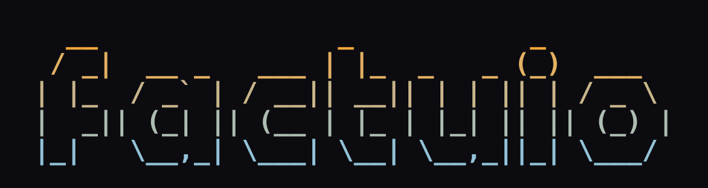
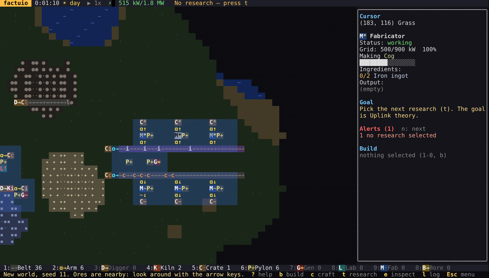
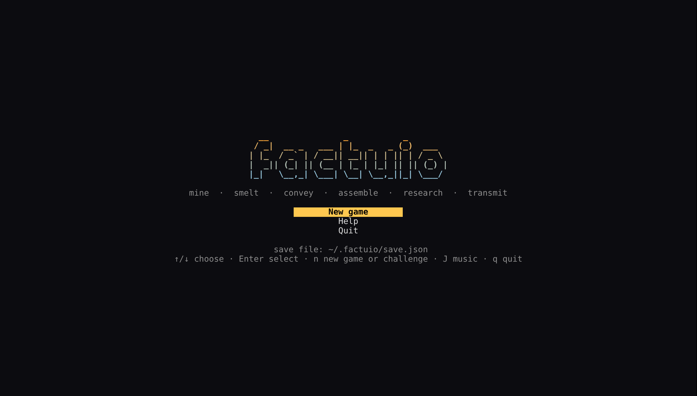
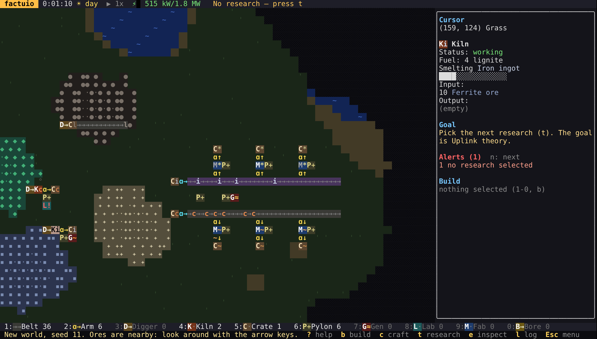
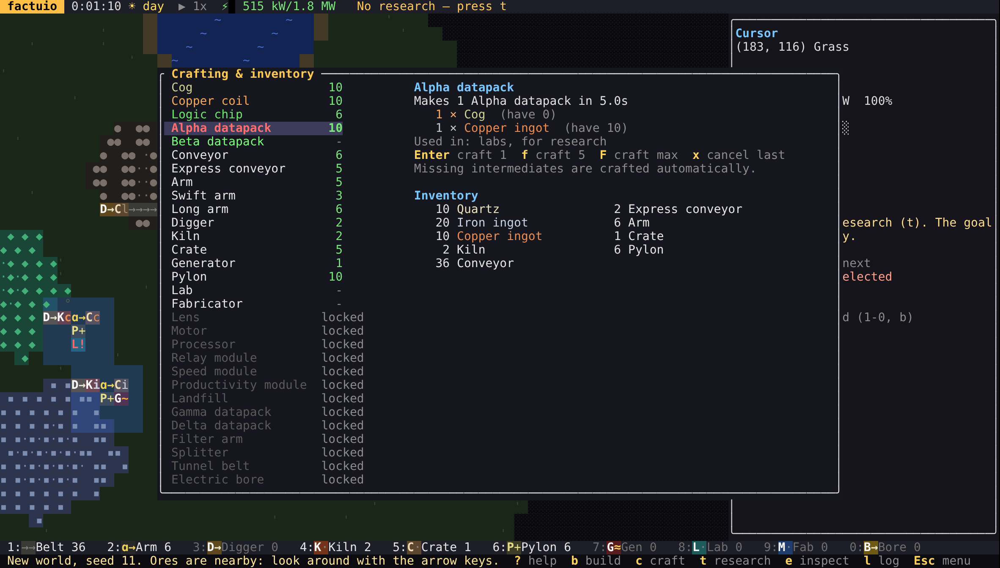
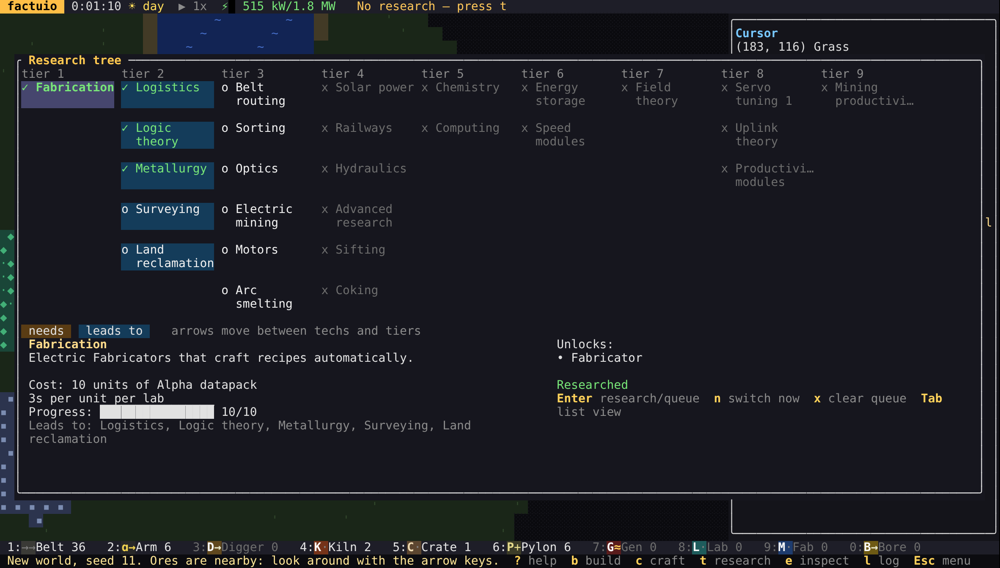
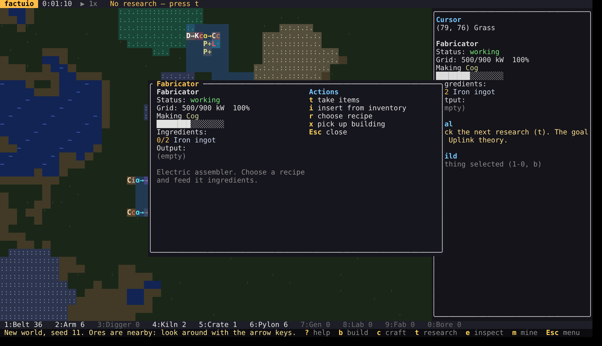
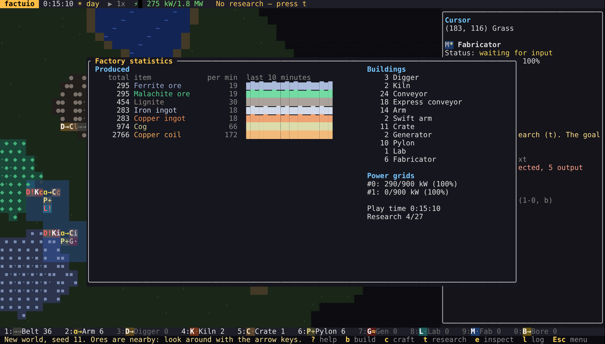

<p align="center">
  
</p>

<p align="center"><b>A factory-automation game for your terminal</b>, written in Rust with <a href="https://ratatui.rs">ratatui</a>.</p>

Start with a handful of buildings on a procedurally generated map. Mine ore, smelt it,
move it around on conveyors and arms, craft parts, research new technology, and finally
build the **Uplink array** and feed it 20 relay modules to win.



## Install and run

Download a prebuilt binary for Linux, macOS or Windows from the
[Releases page](https://github.com/ja7er/factuio/releases), unpack it and run `factuio`.
On macOS, if Gatekeeper blocks the unsigned binary, run `xattr -d com.apple.quarantine factuio`.

Or build from source with a recent Rust toolchain (edition 2024, Rust 1.85+):

```sh
cargo run --release
```

Options:

```
--new             start a new game immediately
--continue        load the save file immediately
--seed <N>        world seed for a new game
--save <PATH>     save file location (default: ~/.factuio/save.json)
--ascii           ASCII-only glyphs (for terminals without Unicode arrows)
--256             force 256-colour mode (macOS Terminal.app, older terminals)
--truecolor       force 24-bit colour
```

A terminal of at least 100×30 is recommended. Colours are 24-bit when your terminal
advertises it through `COLORTERM`; otherwise they fall back to the 256-colour palette.

## Screenshots

| | |
| --- | --- |
|  |  |
| Title screen | A starter base: diggers feeding kilns, arms unloading into crates |
|  |  |
| Hand crafting, with missing intermediates made automatically | The research tree |
|  |  |
| Inspecting a fabricator | Production statistics and power grids |

## Controls

| Key | Action |
| --- | --- |
| Arrows / WASD | Move the cursor (Shift or capital WASD: 8 tiles) |
| 1–9, 0 | Select a building from the hotbar |
| b | Building list (press 1–0 there to assign hotbar slots) |
| Space / Enter | Place the selected building, or inspect what's under the cursor |
| r | Rotate the building you're placing (or the one under the cursor) |
| v | Paint mode: moving the cursor keeps building; conveyors follow your path |
| q | Clear selection / pick the building under the cursor (fabricators keep their recipe) |
| x / Delete | Pick up a building and everything inside it |
| u | Undo the last build or pick-up (a paint stroke, drag or paste is one step) |
| z | Select an area, then `x` to pick it all up or `y` to copy it as a blueprint |
| e | Inspect: `t` take, `i` insert, `f` add fuel, `r` recipe or rotate |
| m | Mine the ore under the cursor by hand |
| c / i / Tab | Crafting and inventory (`Enter` 1, `f` 5, `F` max, `x` cancel) |
| t | Research tree (`Enter` research or queue, `n` switch now, `x` clear queue) |
| g | Production statistics (rates over the last minute) |
| l | Message log |
| n | Jump to the next building with a problem |
| M | Map overview |
| o | Power coverage overlay |
| p / f | Pause / 4× fast-forward |
| F5 / F9 | Quick save / quick load the current slot (asks first) |
| Esc | Menu (save to or load one of 5 slots, quit) |
| ? | Help |

**Mouse:** left click places or inspects, left drag lays buildings along the path (or selects an
area when nothing is selected), right click or drag picks up, the wheel scrolls, and the hotbar
is clickable.

**Upgrading in place:** placing an express conveyor, swift arm, electric bore or arc furnace over
its basic version swaps it, and the old one goes back to your inventory.

**Blueprints:** copy an area with `z` … `y`, then `Enter` places it at the cursor, `r` rotates
it and `Esc` drops it.

The game autosaves every five minutes, and when you press Ctrl+C or close the terminal,
to a separate `save.autosave.json`, so it never overwrites a save you made yourself.
**Continue** picks whichever save is newest. Every save also keeps the previous file as `.bak`.

### Settings

`~/.factuio/settings.json` (next to your save) is created on first run:

```json
{
  "mouse": true,
  "palette": "default",
  "ascii": false,
  "autosave_minutes": 5,
  "keys": { "mine": "k" }
}
```

`keys` remaps play-screen actions: `rotate`, `paint`, `pick`, `remove`, `inspect`, `mine`,
`build_menu`, `craft`, `research`, `stats`, `log`, `power_overlay`, `pause`, `fast`,
`select_area`, `undo`, `next_alert`, `minimap`. Set `autosave_minutes` to 0 to turn autosave
off, and `mouse` to false to keep your terminal's own text selection.

## How it plays

**Resources.** Four ores spawn near the start, with richer patches further out:
ferrite, malachite, lignite (fuel) and quartz.

**Production chain.**

```
ferrite ──kiln──▶ iron ingot ──▶ cog, conveyor, crate ...
malachite ─kiln─▶ copper ingot ─▶ copper coil ─▶ logic chip
quartz ──kiln──▶ glass ─────────▶ lens (Optics)
iron ingot ×5 ─kiln─▶ steel beam (Metallurgy) ─▶ motor (Motors)
chip + lens + coil ─▶ processor (Computing)
processor + motor + steel ─▶ relay module ─▶ Uplink array ★
```

**Buildings.**

| Map | Building | Notes |
| --- | --- | --- |
| `D→` | Digger | Burns lignite, mines the 3×3 area under it, pushes ore ahead |
| `B→` | Electric bore | Electric, twice as fast (Electric mining) |
| `K` | Kiln | Burns lignite to smelt |
| `E` | Arc furnace | Electric, twice as fast (Arc smelting) |
| `→→` | Conveyor / express conveyor | Items ride on it, shown by their letter; side-loading works |
| `ɑ→` | Arm / swift arm | Grabs from behind, drops ahead; only picks what the target can use |
| `C` | Crate | Stores 800 items |
| `G` | Generator | Burns lignite for 900 kW |
| `P` | Pylon | Powers a 5×5 area and links to pylons up to 7 tiles away |
| `S` | Sun panel | Free 60 kW (Solar power) |
| `M` | Fabricator | Electric assembler for any crafting recipe (Fabrication) |
| `L` | Lab | Consumes datapacks for the current research |
| `U` | Uplink array | Win condition (Uplink theory) |

**Power.** Each pylon network sums its generators and panels. When demand exceeds
supply every machine on that network slows down proportionally.

**Research.** Twelve technologies use Alpha, Beta and Gamma datapacks. Pick one
with `t`, then keep your labs supplied.

The sidebar always shows a **Goal** line telling you what to do next.

## Development

```sh
cargo test            # simulation, crafting, save/load, UI rendering, scripted playthroughs
cargo clippy --all-targets
```

The screenshots are rendered from the real UI: `FACTUIO_DUMP=<dir> cargo test dump_screens -- --ignored`
writes HTML snapshots of each screen (and the logo) that can be captured with any headless browser.

Code layout:

- `src/items.rs`: items, buildings, directions
- `src/recipes.rs`: recipes and the tech tree
- `src/world.rs`: map generation and the tick simulation (belts, arms, miners, furnaces, fabricators, labs, power)
- `src/game.rs`: player inventory, hand crafting, building actions, save/load
- `src/app.rs`: screens and keyboard handling
- `src/ui.rs`: ratatui rendering
- `src/playtest.rs`: scripted playthroughs used by the tests

The simulation runs at 20 ticks per second and is deterministic for a given seed.
